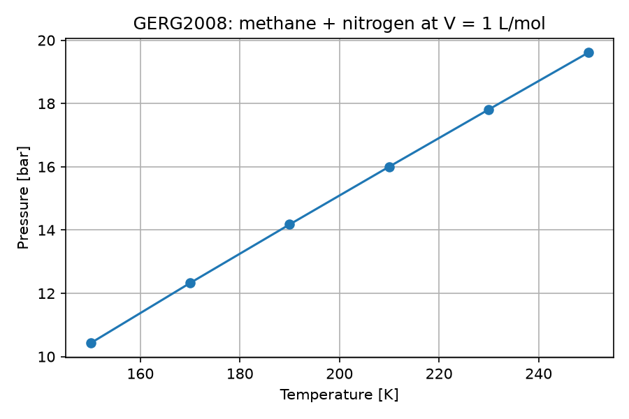

[TOC]

# GERG2008

The GERG2008 equation of state is a **multifluid** model for natural-gas
mixtures. It is based on the reduced Helmholtz energy and is the reference model
of the GERG2008 monograph by Kunz and Wagner.

Use it when your mixture is built from the 21 components the model supports and
you want a well-documented reference calculation without assembling critical
constants, binary interaction parameters or a mixing rule yourself. Compared
with a cubic EOS, the model is more expensive to evaluate and it comes with a
fixed parameterization: you cannot supply your own pure-component or binary
data.

This page explains what the model computes, what data it needs (very little),
how to build it, and how to read its results.

# Theory

## Why a Helmholtz energy

An equation of state relates pressure, volume and temperature. A Helmholtz
energy model stores the same information in a thermodynamic potential whose
derivatives give the other properties. `yaeos` uses the **residual** Helmholtz
energy \(A^r\): the difference between the real fluid and an ideal gas at the
same amount, volume and temperature.

Let \(n_i\) be the amount of component \(i\) in mol, \(n=\sum_i n_i\) the total
amount, \(x_i=n_i/n\) the mole fraction, \(T\) the absolute temperature in K,
and \(V\) the total volume in L. The residual Helmholtz energy is

\[
A^r(\mathbf n,V,T)=nRT\,\alpha^r(\delta,\tau,\mathbf x),
\]

where \(\alpha^r\) is the dimensionless reduced residual Helmholtz energy and
\(R\) is the gas constant in bar L/(mol K). The reduced density \(\delta\) and
reduced inverse temperature \(\tau\) are

\[
\delta=\frac{\rho}{\rho_r(\mathbf x)},\qquad \tau=\frac{T_r(\mathbf x)}{T},
\]

with \(\rho=n/V\) the molar density in mol/L, \(\rho_r=1/V_r\) the reducing
density in mol/L, and \(T_r\) the reducing temperature in K (not the reduced
temperature \(T/T_c\) used on the cubic pages). Each pure fluid keeps its own
accurate Helmholtz equation, and the composition-dependent \(\rho_r\) and
\(T_r\) combine them into a mixture: this is the "multifluid" idea.

## The mixture residual energy

The implementation splits the reduced residual energy into a pure-fluid part
and a binary departure part:

\[
\alpha^r(\delta,\tau,\mathbf x)=
\sum_{i=1}^{N_c} x_i\,\alpha^{o,i}_r(\delta,\tau)
+\sum_{i=1}^{N_c-1}\sum_{j=i+1}^{N_c} x_i x_j\,F_{ij}\,\alpha^{ij}_r(\delta,\tau)
\]

where \(N_c\) is the number of components. The \(\alpha^{o,i}_r\) are the
tabulated pure-component residual Helmholtz energies of component \(i\), and
\(\alpha^{ij}_r\) is the departure function of the pair \((i,j)\). The
dimensionless factor \(F_{ij}\) scales a pair's departure function; it is zero
for pairs that have no departure function, in which case the pair contributes
nothing to this sum.

## Composition-dependent reducing functions

The reducing volume \(V_r\) (L/mol) and reducing temperature \(T_r\) (K) are
built from the pure-component critical data and the binary reducing parameters
\(B_v,G_v,B_t,G_t\):

\[
V_r=\sum_i x_i^2 V_{c,i}
+\sum_{i<j} 2x_ix_j B^v_{ij}G^v_{ij}\frac{x_i+x_j}{(B^v_{ij})^2x_i+x_j}
\frac{1}{8}\left(\rho^{-1/3}_{c,i}+\rho^{-1/3}_{c,j}\right)^3,
\]

\[
T_r=\sum_i x_i^2 T_{c,i}
+\sum_{i<j} 2x_ix_j B^t_{ij}G^t_{ij}\frac{x_i+x_j}{(B^t_{ij})^2x_i+x_j}
\sqrt{T_{c,i}T_{c,j}}.
\]

Here \(V_{c,i}\) is the critical volume of component \(i\) in L/mol,
\(T_{c,i}\) its critical temperature in K, and \(\rho_{c,i}=1/V_{c,i}\) its
critical density in mol/L. Every binary pair has reducing parameters, so the
mixture critical behavior changes with composition even when no departure
function is present.

## Which pairs have a departure function

Only some pairs carry a binary departure function. In the tabulated data the
following pairs have one (the numbers are the internal GERG2008 table indices,
listed in the component table further down):

| Pair | Components | \(F_{ij}\) |
|:-----|:-----------|:-----------|
| 1-2 | methane + nitrogen | 1 |
| 1-3 | methane + carbon dioxide | 1 |
| 1-4 | methane + ethane | 1 |
| 1-5 | methane + propane | 1 |
| 1-6 | methane + n-butane | 1 |
| 1-7 | methane + isobutane | 0.771035405688 |
| 1-15 | methane + hydrogen | 1 |
| 2-3 | nitrogen + carbon dioxide | 1 |
| 2-4 | nitrogen + ethane | 1 |
| 4-5 | ethane + propane | 0.130424765150 |
| 4-6 | ethane + n-butane | 0.281570073085 |
| 4-7 | ethane + isobutane | 0.260632376098 |
| 5-6 | propane + n-butane | 0.0312572600489 |
| 5-7 | propane + isobutane | -0.0551609771024 |
| 6-7 | n-butane + isobutane | -0.0551240293009 |

For every other pair (for example methane + water, methane + n-pentane,
carbon dioxide + water, or anything involving helium or argon) the mixture
interaction is described **only** by the composition-dependent reducing
functions. This is a property of the parameterization, not a numerical
failure, and it is worth knowing before using the model for a mixture that
relies on a strong unlike attraction, such as a water-bearing gas.

# Data requirements

The only input the model needs is the **list of components**. Pure-component
coefficients, binary departure functions, binary reducing parameters and the
critical constants all come from the built-in GERG2008 tables. The model type
is [[Gerg2008]] and it is built with [[gerg_2008]].

The identifiers are fields of the public object `G2008Components`:

| Identifier | Component | Identifier | Component |
|:-----------|:----------|:-----------|:----------|
| `methane` | Methane | `nonane` | n-Nonane |
| `nitrogen` | Nitrogen | `decane` | n-Decane |
| `carbon_dioxide` | Carbon dioxide | `hydrogen` | Hydrogen |
| `ethane` | Ethane | `oxygen` | Oxygen |
| `propane` | Propane | `carbon_monoxide` | Carbon monoxide |
| `nbutane` | n-Butane | `water` | Water |
| `isobutane` | Isobutane | `hydrogen_sulfide` | Hydrogen sulfide |
| `npentane` | n-Pentane | `helium` | Helium |
| `isopentane` | Isopentane | `argon` | Argon |
| `nhexane` | n-Hexane | | |
| `nheptane` | n-Heptane | | |
| `noctane` | n-Octane | | |

@note
The component names are fields of `G2008Components`, not integer constants.
Use `G2008Components%methane`, for example, not `methane`.
@endnote

The order of the identifiers is the order of the model. **Every** composition
vector, amount vector and property result follows that order. Listing the same
components in a different order gives a different model object, so build the
identifier list once and reuse it; do not reorder it between calls.

The public API uses **mol, total L, K and bar**, exactly like the other models.
The critical data of the selected components are available afterwards through
`model%components%tc` (K), `%pc` (bar), `%w` (acentric factor) and `%vc`
(L/mol), which is useful when you want to see what the model believes about a
component.

# Complete example: build, evaluate, saturate

This program builds a methane + nitrogen model, evaluates a homogeneous state,
and then asks a separate solver for the bubble point at the same temperature.
At a bubble point the input amounts describe the **liquid** phase, and `sat%y`
is the incipient vapor composition.

```fortran
program gerg_example
   use yaeos, only: pr, R, Gerg2008, gerg_2008, G2008Components
   use yaeos, only: EquilibriumState, saturation_pressure
   use, intrinsic :: ieee_arithmetic, only: ieee_is_finite
   implicit none

   type(Gerg2008) :: model
   type(EquilibriumState) :: sat
   real(pr) :: n(2)
   real(pr) :: T
   real(pr) :: P
   real(pr) :: V
   real(pr) :: Pideal
   real(pr) :: Z

   ! Methane first, nitrogen second: this fixes the component order.
   model = gerg_2008([ &
      G2008Components%methane, &
      G2008Components%nitrogen &
      ])

   n = [0.9_pr, 0.1_pr] ! mol; total 1 mol, so x = [0.9, 0.1]
   T = 150.0_pr ! K
   V = 1.0_pr ! total L

   call model%pressure(n, V, T, P)
   if (.not. ieee_is_finite(P)) error stop "Nonfinite pressure"
   Pideal = sum(n)*R*T/V
   Z = P/Pideal
   print *, "Pressure [bar]: ", P
   print *, "Compressibility Z [-]: ", Z

   sat = saturation_pressure(model, n, T, kind="bubble")
   if (.not. ieee_is_finite(sat%P)) error stop "Nonfinite bubble pressure"
   if (sat%P <= 0.0_pr) error stop "Invalid bubble pressure"
   if (.not. all(ieee_is_finite(sat%y))) error stop "Nonfinite vapor composition"
   print *, "Saturation pressure [bar]: ", sat%P
   print *, "Vapor composition: ", sat%y
end program gerg_example
```

How to read this output:

- The compressibility factor \(Z=PV/(nRT)\) compares the model with an ideal
  gas at the same state. Here \(Z<1\) because attractive interactions reduce
  the pressure; at very low density it should approach one.
- The bubble pressure is **not** the pressure of the state evaluated above.
  `pressure` evaluates the equation of state at a volume you choose; the
  saturation routine searches for the state where liquid and vapor coexist.
- The vapor composition is enriched in the more volatile component, as
  expected at a bubble point.

## A second example: temperature scan at fixed density

This complete program evaluates pressure at a fixed volume over a range of
temperatures. It is a model evaluation only: it does not look for phases.

```fortran
program gerg_density_scan
   use yaeos, only: pr, Gerg2008, gerg_2008, G2008Components
   implicit none

   type(Gerg2008) :: model
   real(pr) :: n(2)
   real(pr) :: V
   real(pr) :: T
   real(pr) :: P
   integer :: i

   model = gerg_2008([ &
      G2008Components%methane, &
      G2008Components%nitrogen &
      ])

   n = [0.9_pr, 0.1_pr]
   V = 1.0_pr

   do i = 0, 5
      T = 150.0_pr + 20.0_pr * real(i, pr)
      call model%pressure(n, V, T, P)
      print *, "T =", T, "K, P =", P, "bar"
   end do
end program gerg_density_scan
```



This figure is a scan of the model at one volume. It is an illustration of the
API, not a validation dataset: compare the curve with experimental data for
the mixture before drawing conclusions from it.

# Implementation details

`Gerg2008` extends `ArModelAdiff`, so all the standard `ArModel` methods are
available, including `pressure`, `volume`, `lnphi_pt`, the residual property
routines and the phase-equilibrium routines.

The model is evaluated with automatic differentiation using hyperdual numbers,
so first and second derivatives with respect to amount, volume and temperature
come from the same code path.

The `volume` method is specialized: it uses a Newton solver in log-volume,
initialized with the Soave-Redlich-Kwong volume. This is necessary because the
GERG2008 Helmholtz function does not provide a simple analytical covolume. The
root selection `"liquid"`, `"vapor"` and `"stable"` behaves as in the other
models: `"stable"` compares the Gibbs energy of the two roots.

The model overrides `ln_activity_coefficient`: each pure-fluid reference is
evaluated with a separate one-component GERG2008 model.

# Interpretation, checks and pitfalls

Useful checks on a first run:

- **Ideal-gas limit.** Increase the volume at fixed temperature and
  composition; the pressure must approach `sum(n)*R*T/V` and \(Z\to1\).
- **Order independence of the result.** Building the model with the
  components in the opposite order and swapping the amounts accordingly gives
  the same pressure to machine precision. A different answer means the
  composition vector no longer matches the model order.
- **Component sanity.** `model%components%tc` and `%pc` come from the tables,
  not from your input, and are a quick way to confirm that the right
  components were selected.
- **Root verification.** After `volume`, call `pressure` with the returned
  volume and compare with the requested pressure.

Pitfalls specific to this model:

- **A failed volume solve returns a negative volume.** The solver returns
  \(-1\) instead of a physical volume when Newton iteration does not
  converge. Always check that the volume is positive before using it; a
  negative volume propagated into a pressure call gives a meaningless number
  rather than an error.
- **No user parameters.** There is no way to supply your own pure-component
  coefficients or binary interactions to `gerg_2008`. If you need them, use a
  model that accepts them, such as a cubic EOS with mixing rules or PC-SAFT.
- **Departure functions are limited.** As listed above, many pairs have no
  departure function. Mixtures such as methane + water or carbon dioxide +
  water are therefore described only through the reducing functions.
- **The model is a fixed parameterization.** It was developed for natural-gas
  mixtures. Using it far outside that range is possible but the original
  parameterization no longer guarantees accuracy.
- **A converged calculation is not a validated one.** Solver convergence says
  nothing about whether the model describes your system; that requires
  comparison with experimental data.

# Limits of the model versus limits of the solver

These are different failures and deserve different responses:

| Symptom | Likely cause | What to do |
|:--------|:-------------|:-----------|
| Volume solve returns \(-1\) | Newton iteration did not converge | Check that the state is inside the model's range; try a different `root_type` |
| Bubble or flash routine fails to converge | Phase-equilibrium solver, not the model | Supply better initial guesses (`p0`, `y0`, `t0`) or a better starting state |
| Converged but implausible result | Model or parameters unsuitable for the system | Compare with data; check the component set and the pair coverage listed above |

# Next reading

- [Thermodynamic fundamentals](../fundamentals.html) for amounts,
  compositions, units and the difference between a model and a solver.
- [Saturation points](../phase_equilibrium/saturation_points.html) for bubble
  and dew points and the checks that apply to them.
- [Cubic EOS](cubics/index.html) when you need to supply your own critical
  data and binary interactions, or when cost matters.

# References

- Kunz, O., & Wagner, W. (2012). The GERG-2008 wide-range equation of state for
  natural gases and other mixtures: an expansion of GERG-2004. *Journal of
  Chemical & Engineering Data*, 57(11), 3032-3091.
- `app/gerg_properties.f90` contains a runnable property calculation.
