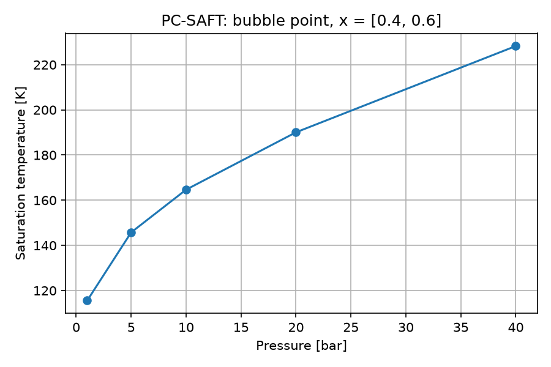

[TOC]

# PC-SAFT

The Perturbed-Chain Statistical Associating Fluid Theory (PC-SAFT) equation of
state is available as [[PcSaft]]. It is constructed with [[init_pcsaft]].

Use it when a molecular-size/chain description and suitable PC-SAFT parameter
sets are available, for example for non-associating chain molecules. Rather
than treating a molecule as one object with a single covolume, PC-SAFT represents
it as connected segments. Crowding resists compression, connectivity changes
the reference fluid, and dispersion attractions lower the free energy.

The name includes “associating”, but **this implementation has no association
term**. It is not a general-purpose water/alcohol model, nor does it add a
separate polar contribution. A parameter set fitted for another PC-SAFT variant
may rely on terms absent here.

The following is a constructor **snippet**, with parameter arrays defined below:

```fortran
use yaeos, only: pr, PcSaft, init_pcsaft

type(PcSaft) :: model

model = init_pcsaft(m, sigma, epsilon_k, kij)
```

# Theory

PC-SAFT is a residual Helmholtz model based on a perturbation expansion around a
hard-chain reference fluid. Let \(A^{res}\) be total residual Helmholtz energy,
\(N\) the number of molecules, \(k_B\) Boltzmann's constant, and \(T\) absolute
temperature. Write \(a^r=A^{res}/(Nk_BT)=A^{res}/(nRT)\), with \(n\) the total
mole amount and \(R\) the gas constant. Superscripts `hc`, `hs`, and `disp`
mean hard chain, hard sphere, and dispersion, respectively. Then

$$
   a^r = a^{\mathrm{hc}} + a^{\mathrm{disp}}
$$

## Hard-chain contribution

Let \(x_i=n_i/n\) be molecular mole fraction, \(m_i\) the dimensionless
segment count, and \(\bar m=\sum_i x_i m_i\) its mixture average. Let
\(g_{ii}^{hs}\) be the dimensionless same-component hard-sphere contact value.
The hard-chain term already combines the hard-sphere reference and connectivity:

$$
   a^{\mathrm{hc}} = \bar m a^{\mathrm{hs}}
   - \sum_i x_i (m_i - 1) \ln g_{ii}^{\mathrm{hs}}
$$

Do **not** add a separate chain term again. Here \(a^{hs}\) is the
dimensionless hard-sphere reference **per segment**, not a second whole-molecule
Helmholtz contribution. For the size mixture it uses the following mixture
hard-sphere expression (reducing to Carnahan-Starling for equal diameters).
The moments \(\zeta_0,\ldots,\zeta_3\) are defined immediately below:

$$
   a^{\mathrm{hs}} =
   \frac{1}{\zeta_0}
   \left(
      \frac{3 \zeta_1 \zeta_2}{1-\zeta_3}
      + \frac{\zeta_2^3}{\zeta_3(1-\zeta_3)^2}
      + \left(\frac{\zeta_2^3}{\zeta_3^2} - \zeta_0\right)
        \ln(1-\zeta_3)
   \right)
$$

Let \(\rho_N=N/V\) be molecular number density in Å⁻³, \(\sigma_i\) the segment
diameter in Å, and \(E_i=\epsilon_i/k_B\) the segment energy parameter in K
(the input `epsilon_k`). Define the temperature-dependent effective diameter
\(d_i=\sigma_i[1-0.12\exp(-3E_i/T)]\). The moments are

$$
   \zeta_q = \frac{\pi}{6}\rho_N \sum_i x_i m_i d_i^q
   \qquad (q = 0,\dots,3).
$$

In particular, \(\zeta_0=(\pi/6)\rho_N\bar m\), **not** \(\bar m\).
The packing fraction \(\eta=\zeta_3\) is dimensionless; the other moments
have units Å to the power \(q-3\). The contact function uses effective
diameter \(d_i\), not the uncorrected \(\sigma_i\):

$$
   g_{ii}^{\mathrm{hs}} =
   \frac{1}{1-\zeta_3}
   + \frac{3\,\zeta_2\,d_i}{2(1-\zeta_3)^2}
   + \frac{\zeta_2^2\,d_i^2}{2(1-\zeta_3)^3}.
$$

## Chain contribution

The chain contribution is included in the hard-chain term through the
\((m_i-1)\) factors. It accounts for the connectivity of the segments that
form each molecule.

## Dispersion contribution

The unlike diameter \(\sigma_{ij}\) is in Å, the unlike energy parameter
\(E_{ij}\) is in K, and \(k_{ij}\) is a dimensionless binary correction.
The combining rules are

$$
   \sigma_{ij}=\frac{\sigma_i+\sigma_j}{2},\qquad
   E_{ij}=\sqrt{E_iE_j}(1-k_{ij}).
$$

The dimensionless integrals \(I_1\) and \(I_2\) and reference compressibility
correction \(C_1\) depend on packing fraction and mean chain length. The
implemented second-order dispersion expression is

$$
   a^{\mathrm{disp}}=-2\pi\rho_N I_1
   \sum_{i,j}x_ix_jm_im_j\frac{E_{ij}}{T}\sigma_{ij}^3
   -\pi\rho_N\bar m C_1 I_2
   \sum_{i,j}x_ix_jm_im_j\left(\frac{E_{ij}}{T}\right)^2\sigma_{ij}^3.
$$

The temperature factors and \(C_1\) must not be omitted. Define the
dimensionless polynomial coefficients \(a_q(\bar m)\), \(b_q(\bar m)\) from
the Gross-Sadowski tables (stored in the source as `a_coeffs` and `b_coeffs`,
each with three rows). Then

$$
   I_1=\sum_{q=0}^{6}a_q(\bar m)\eta^q,\qquad
   I_2=\sum_{q=0}^{6}b_q(\bar m)\eta^q,
$$

with the mean-segment dependence

\[
a_q=a_q^{(0)}+\left(1-\frac{1}{\bar m}\right)a_q^{(1)}
+\left(1-\frac{1}{\bar m}\right)\left(1-\frac{2}{\bar m}\right)a_q^{(2)},
\]

and the same form for \(b_q\). The packing fraction \(\eta\) is the third
moment \(\zeta_3\), and

\[
C_1=\left[1+\bar m\frac{8\eta-2\eta^2}{(1-\eta)^4}
+(1-\bar m)\frac{20\eta-27\eta^2+12\eta^3-2\eta^4}
{[(1-\eta)(2-\eta)]^2}\right]^{-1}.
\]

Although the polynomial coefficients have no explicit temperature argument, the
integrals are not temperature-independent at fixed density: \(\eta\) uses
the temperature-dependent \(d_i\). Dispersion uses \(\sigma_{ij}\), while
the packing and contact terms use \(d_i\); these are different quantities in
this implementation.

## Units

The internal number density \(\rho_N\) is in molecules per ų, and the parameters are
\(m\) (segments per molecule), \(\sigma\) (segment diameter in Angstrom),
and \(\epsilon/k\) (segment energy in K). The binary interaction matrix
\(k_{ij}\) is dimensionless.

The model parameters are:


| Argument | Meaning | Units |
|:---------|:--------|:------|
| `m` | Number of segments per molecule | - |
| `sigma` | Segment diameter | Angstrom |
| `epsilon_k` | Segment energy divided by Boltzmann's constant | K |
| `kij` | Optional binary interaction matrix | - |

`m`, `sigma`, and `epsilon_k` are arrays with one entry per component. `kij`
is an optional `nc x nc` matrix; when it is omitted, all binary interaction
parameters are set to zero.

Use positive `m`, `sigma`, and `epsilon_k`, with consistent parameter provenance.
`m` is an effective segment count and may be noninteger. All arrays and both
axes of `kij` must use the same component order. Supply symmetric binary
corrections with zero diagonals; do not transfer cubic-EOS `kij` values to
PC-SAFT without validation.

The public property API still uses **mol, total L, K, and bar**, not ų:
the code converts number density using Avogadro's constant and
`1 L = 10^27 Å^3`. `sigma` is the exception to the usual macroscopic unit set;
it is not in metres or litres.

# Example

The following complete program uses the methane/n-butane parameter set shown
in Gross and Sadowski (2001). The zero-binary-correction mixture is a starting
point, not a fitted prediction for this mixture. It first evaluates pressure
at a prescribed homogeneous state and then asks a separate solver for a bubble
point at the same temperature. At a bubble point `n/sum(n)` is the liquid
composition and `sat%y` is the incipient vapor composition.

```fortran
program pcsaft_example
   use yaeos, only: pr, PcSaft, init_pcsaft
   use yaeos, only: EquilibriumState, saturation_pressure
   use, intrinsic :: ieee_arithmetic, only: ieee_is_finite
   implicit none

   type(PcSaft) :: model
   type(EquilibriumState) :: sat
   real(pr) :: m(2)
   real(pr) :: sigma(2)
   real(pr) :: epsilon_k(2)
   real(pr) :: n(2)
   real(pr) :: T
   real(pr) :: V
   real(pr) :: P

   ! Methane and n-butane
   m = [1.0000_pr, 2.3316_pr]
   sigma = [3.7039_pr, 3.7086_pr]
   epsilon_k = [150.03_pr, 222.88_pr]

   model = init_pcsaft(m, sigma, epsilon_k)

   n = [0.4_pr, 0.6_pr]
   T = 300.0_pr
   V = 10.0_pr ! total L for one mole

   call model%pressure(n, V, T, P)
   print *, "Pressure: ", P, " bar"

   sat = saturation_pressure(model, n, T, kind="bubble")
   if (.not. ieee_is_finite(sat%P)) error stop "Nonfinite bubble pressure"
   if (sat%P <= 0.0_pr) error stop "Invalid bubble pressure"
   if (.not. all(ieee_is_finite(sat%y))) error stop "Nonfinite vapor composition"
   print *, "Saturation pressure: ", sat%P, " bar"
   print *, "Vapor composition: ", sat%y
end program pcsaft_example
```

At this low-density pressure-evaluation state, compare pressure with the
ideal-gas value `sum(n)*R*T/V` (`R` is exported by `yaeos`). Increase volume
to check approach to the ideal-gas limit. Pressure evaluated at a chosen volume
is **not** the saturation pressure, and need not equal `sat%P`.
The finite/positive checks are necessary but insufficient: also check
normalization, nonnegative phase compositions, distinct liquid/vapor roots
away from criticality, and equality of component fugacities. See the
[saturation guide](../phase_equilibrium/saturation_points.html).

# How `init_pcsaft` works

PC-SAFT is a residual Helmholtz model, but many `yaeos` routines also need
critical constants and acentric factors. `init_pcsaft` computes them from the
PC-SAFT parameters:

1. `find_critical_points_all_components` calculates the pure-component critical
   temperature, pressure, and volume from the PC-SAFT equation.
2. `Psat_pure` evaluates the saturation pressure at \(T_r = 0.7\).
3. The acentric factor is obtained from the definition
   \(\omega = -1 - \log_{10}(P^{sat}/P_c)\).

This initialization is more expensive than constructing a cubic model, because
it requires solving the critical point and a saturation point for each
component. It is done once per model.

These are model-predicted critical constants, not additional experimental
inputs. The initializer obtains a `converged` array internally but does not
return it to callers. Check that `model%components%Tc`, `%Pc`, and `%w` are
finite and physically plausible before trusting downstream initial guesses.
Unusual parameter sets may fail during this initialization, before any mixture
property call is made.

# A second example: saturation-temperature scan

```fortran
program pcsaft_saturation_scan
   use yaeos, only: pr, PcSaft, init_pcsaft
   use yaeos, only: EquilibriumState, saturation_temperature
   use, intrinsic :: ieee_arithmetic, only: ieee_is_finite
   implicit none

   type(PcSaft) :: model
   type(EquilibriumState) :: sat
   real(pr) :: m(2)
   real(pr) :: sigma(2)
   real(pr) :: epsilon_k(2)
   real(pr) :: n(2)
   real(pr) :: Pvals(5)
   integer :: i

   m = [1.0000_pr, 2.3316_pr]
   sigma = [3.7039_pr, 3.7086_pr]
   epsilon_k = [150.03_pr, 222.88_pr]

   model = init_pcsaft(m, sigma, epsilon_k)

   n = [0.4_pr, 0.6_pr]

   Pvals = [1.0_pr, 5.0_pr, 10.0_pr, 20.0_pr, 40.0_pr]

   do i = 1, size(Pvals)
      sat = saturation_temperature(model, n, P=Pvals(i), kind="bubble", t0=250.0_pr)
      if (.not. ieee_is_finite(sat%T)) error stop "Nonfinite saturation temperature"
      if (sat%T <= 0.0_pr) error stop "Invalid saturation temperature"
      print *, "P =", Pvals(i), "bar, Tsat =", sat%T, "K"
   end do
end program pcsaft_saturation_scan
```



This retained illustration is a scan of bubble temperature, not a phase
envelope or a validation dataset. The program is complete and each point is a
separate nonlinear solve. A fixed `t0` may fail in another pressure range;
continuing from the previous converged point can be more reliable.

# Implementation details

`PcSaft` extends `ArModelTapenade`. The residual Helmholtz energy and its
derivatives are generated with Tapenade, so the model provides the full set of
first and second derivatives required by the phase-equilibrium routines.

The model implements:

- `ar`, `ar_d`, `ar_b`, `ar_d_b`, and `ar_d_d` for the Tapenade interface.
- A specialized `volume` solver based on Michelsen's method.
- `get_v0`, which returns the total segment volume. This is the physical lower
   scale used to initialize the liquid root, not a universal stable-liquid bound.

The PC-SAFT contribution contains the hard-sphere, chain, and dispersion terms
of the Gross-Sadowski formulation. The current implementation does not include
the association term, so it should not be used for associating fluids such as
water or alcohols without an additional model.

# Notes and recommendations

- Use the model-specific units: `sigma` in Angstrom and `epsilon_k` in kelvin.
- Provide `kij` for mixtures when binary interaction parameters are available.
   Use the usual symmetric convention with zero diagonals.
- The segment number `m` can be a real number; it is not restricted to integers.
- The initialization calculates critical constants numerically. If a component
  does not have a stable critical point under PC-SAFT, `init_pcsaft` will not
  produce reliable acentric factors.
- For associating fluids, the association contribution is not implemented in
  this version.
- The model is significantly more expensive than a cubic equation of state.
  For phase-envelope calculations, provide good initial guesses to the
   saturation and flash routines.

Finite positive pressure does not establish phase stability. The packing
fraction must stay below the hard-sphere singularity at one, and approaching
that singularity is not a route to a trustworthy compressed-liquid prediction.
Distinguish missing physical contributions or unsuitable parameters from
volume-root and phase-equilibrium convergence failures.

# Next reading

See the [EOS property guide](index.html),
[thermodynamic fundamentals](../fundamentals.html),
[saturation points](../phase_equilibrium/saturation_points.html), and
[flash calculations](../phase_equilibrium/flash.html). For a lower-input baseline,
compare the [cubic models](cubics/index.html) using the same state and composition.

# References

- Gross, J., & Sadowski, G. (2001). Perturbed-Chain SAFT: An Equation of State
  Based on a Perturbation Theory for Chain Molecules. *Industrial & Engineering
  Chemistry Research*, 40(4), 1244-1260.
