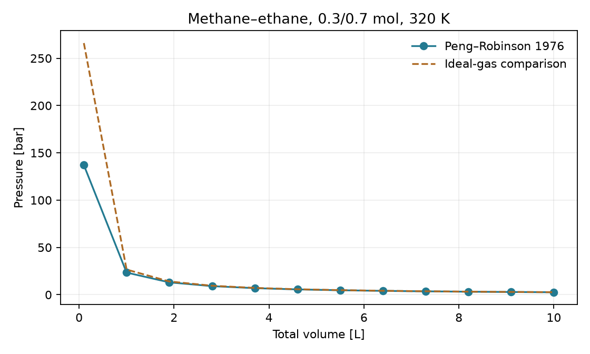

[TOC]

# Your first calculation with yaeos

This tutorial goes from an empty Fortran project to a pressure calculation,
then shows how to solve for volume and generate a pressure–volume curve.
You need basic familiarity with variables and arrays, but not with the
derivation of an equation of state (EOS).

The example uses a methane–ethane mixture. We will choose a model, supply
component data in a consistent order, and ask it to predict a homogeneous
fluid's pressure. Finding how much liquid and vapor coexist is a different
task, introduced in the [phase-equilibrium guide](phase_equilibrium/index.html).

## 1. Prepare a project

`yaeos` is a modern Fortran library distributed as an
[`fpm`](https://fpm.fortran-lang.org) package. Install a Fortran compiler,
`fpm`, Git, and the BLAS/LAPACK numerical libraries. Building the bundled
automatic-differentiation support also requires a C compiler. On Debian or
Ubuntu the compiler and system-library packages can be installed with:

```bash
sudo apt install gfortran gcc git libblas-dev liblapack-dev
```

Install `fpm` separately following its
[installation guide](https://fpm.fortran-lang.org/install/index.html), then create
a project:

```bash
fpm new first_yaeos --app
cd first_yaeos
```

Add the following dependency to `fpm.toml`. If a `[dependencies]` section
already exists, add the `yaeos` line there rather than creating a second section.

```toml
[dependencies]
yaeos = { git = "https://github.com/ipqa-research/yaeos" }
```

The first build downloads dependencies and can take longer than later builds.
For reproducible work, select a tested release tag or commit using `fpm`'s
`tag` or `rev` dependency options. Examples in these pages describe the API in
this documentation's source revision; an older release may expose different
arguments.

If Fortran itself is new to you, the
[Fortran-lang learning resources](https://fortran-lang.org/learn/) explain
programs, arrays, derived types, and procedure calls.

## 2. Understand the inputs

An EOS relates pressure, volume, temperature, and composition. The
Peng–Robinson 1976 model used here needs each component's critical temperature
`tc`, critical pressure `pc`, and acentric factor `omega`.

A **critical temperature** and **critical pressure** locate the pure fluid's
critical point, where its liquid and vapor become indistinguishable. The
**acentric factor** is a dimensionless descriptor of its vapor-pressure
behavior. These are component data, not the temperature and pressure of the
mixture you are about to calculate.

| Array position | Component | `tc` [K] | `pc` [bar] | `omega` [–] |
|----------------|-----------|----------|------------|-------------|
| 1 | Methane | 190.564 | 45.99 | 0.01142 |
| 2 | Ethane | 305.32 | 48.72 | 0.0995 |

These rounded values are suitable for a tutorial, not a substitute for
selecting consistent data for a validated application. All arrays use this
same component order.

We use 0.3 mol methane and 0.7 mol ethane, a total of 1 mol. At 320 K in a
1 L vessel, the ideal-gas equation would give
\(P=n_{\mathrm{tot}}RT/V\approx26.61\) bar. The EOS accounts for molecular
interactions and will give a different pressure. The ideal-gas value is a
useful scale check, not the expected EOS answer.

## 3. Run a complete pressure calculation

Replace `app/main.f90` with this complete program:

```fortran
program first_yaeos
   use yaeos, only: pr, ArModel, PengRobinson76
   implicit none

   class(ArModel), allocatable :: model
   real(pr) :: tc(2)
   real(pr) :: pc(2)
   real(pr) :: omega(2)
   real(pr) :: n(2)
   real(pr) :: temperature
   real(pr) :: volume
   real(pr) :: pressure

   tc = [190.564_pr, 305.32_pr]
   pc = [45.99_pr, 48.72_pr]
   omega = [0.01142_pr, 0.0995_pr]
   n = [0.3_pr, 0.7_pr]
   temperature = 320.0_pr
   volume = 1.0_pr

   model = PengRobinson76(tc, pc, omega)
   call model%pressure(n, volume, temperature, pressure)

   write(*, '(A,F10.4)') "Pressure [bar]: ", pressure
end program first_yaeos
```

Run it from the project directory:

```bash
fpm run
```

Here is what the important lines do:

* `use yaeos, only: ...` imports the names needed for this calculation.
* `pr` selects the library's floating-point precision. The `_pr` suffix keeps
  literal constants in that precision.
* `class(ArModel), allocatable` declares a variable that can hold different
  residual-Helmholtz EOS model types. You do not have to implement that class.
* `PengRobinson76(...)` constructs and stores the component parameters. It
  does **not** calculate equilibrium at a particular temperature or pressure.
* `model%pressure(...)` evaluates this model at the supplied state and writes
  the answer into the last argument.

For the rounded inputs above, the pressure is approximately **23.4215 bar**,
below the ideal-gas estimate of 26.61 bar. At this particular state, the net
non-ideal correction lowers the pressure; this is not a rule that holds at
every density. Small differences in component data or compiler arithmetic can
change the last displayed digits.

This example has not fitted binary
interaction parameters: the constructor's default mixing rule uses zero
binary interactions. That is a useful starting point, not evidence that those
parameters are suitable for every mixture.

## 4. Solve the inverse problem: volume from pressure

In an experiment you often know pressure and temperature, not volume. The
following **insertable block** goes before `end program first_yaeos` in the
previous program; it reuses `model` and `n`:

```fortran
volume_example: block
   real(pr) :: specified_pressure
   real(pr) :: solved_volume
   real(pr) :: checked_pressure
   real(pr) :: temperature

   specified_pressure = 10.0_pr
   temperature = 320.0_pr
   call model%volume(n, specified_pressure, temperature, solved_volume, &
      root_type="stable")
   if (solved_volume <= 0.0_pr) error stop "Volume calculation failed"

   call model%pressure(n, solved_volume, temperature, checked_pressure)
   write(*, '(A,F10.5)') "Total volume [L]: ", solved_volume
   write(*, '(A,ES12.4)') "Pressure mismatch [bar]: ", &
      checked_pressure - specified_pressure
end block volume_example
```

Re-evaluating pressure at the solved volume should reproduce the specified
pressure to the solver's numerical accuracy. This checks the inverse
calculation, not the model's agreement with experimental data.
The example gives approximately 2.52678 L; in a local run the pressure mismatch
was about \(4\times10^{-10}\) bar, rather than exactly zero.

The `root_type` argument controls the volume branch. `"liquid"` requests the
dense branch, `"vapor"` the dilute branch, and `"stable"` the preferred
homogeneous root. These roots need not be different at every state. In
particular, a stable volume root does not by itself test whether a mixture
would separate into phases with different compositions. See
[thermodynamics essentials](fundamentals.html#a-volume-root-is-not-a-phase-split).

## 5. Generate a pressure–volume isotherm

An **isotherm** is a curve at constant temperature. Insert this block before
the end of the first program to evaluate twelve volumes at 320 K:

```fortran
pv_isotherm: block
   real(pr) :: volume
   real(pr) :: pressure
   real(pr) :: first_volume
   real(pr) :: last_volume
   real(pr) :: step
   integer :: i
   integer, parameter :: n_points = 12

   first_volume = 0.1_pr
   last_volume = 10.0_pr
   step = (last_volume - first_volume) / real(n_points - 1, pr)
   write(*, '(A)') "Volume [L],Pressure [bar]"
   do i = 0, n_points - 1
      volume = first_volume + real(i, pr) * step
      call model%pressure(n, volume, 320.0_pr, pressure)
      write(*, '(F9.4,",",F12.6)') volume, pressure
   end do
end block pv_isotherm
```

Plot the two columns in your preferred plotting tool. The volume range is
deliberately broad: at large volumes the pressure approaches the ideal-gas
behavior, whereas small volumes magnify intermolecular effects. An arbitrary
small volume may be outside a model's physical domain; check before extending
the sweep toward zero.

Some rows of the calculated table are:

| Total volume [L] | Pressure [bar] |
|------------------|----------------|
| 0.1 | 137.063211 |
| 1.0 | 23.421450 |
| 3.7 | 6.940690 |
| 10.0 | 2.625777 |



The markers are the twelve states evaluated by the program; connecting lines
are a guide to the eye. The dashed curve compares the ideal-gas pressure at
those same volumes and temperature.

This is an EOS curve for proposed homogeneous states, not a phase-equilibrium
envelope. At other temperatures, a model curve can pass through unstable
states; those points do not describe a physically stable, uniform sample.

## 6. Request derivatives only when you need them

A derivative tells you how a property changes when an input changes. For
example, `dPdV` is the slope of pressure with respect to total volume while
temperature and mole amounts stay fixed. This insertable block requests that
slope as well as pressure:

```fortran
derivative_example: block
   real(pr) :: pressure
   real(pr) :: slope

   call model%pressure(n, 1.0_pr, 320.0_pr, pressure, dPdV=slope)
   write(*, '(A,ES12.4)') "dP/dV [bar/L]: ", slope
end block derivative_example
```

Optional keyword outputs let you ask for the quantities you need without
implementing numerical differentiation yourself. For normal stable fluid
states this slope is negative: expansion lowers the pressure. Derivatives near
singularities or critical states require more care.

## Units and amount basis

Use bar, litres, kelvin, and moles unless a model-specific parameter is
documented otherwise. The library uses
\(R=0.08314462618\;\mathrm{bar\,L\,mol^{-1}\,K^{-1}}\).
Extensive energies are in bar·L, and \(1\;\mathrm{bar\,L}=100\;\mathrm J\).

Here the amounts sum to one mole, so the numerical total volume equals the
numerical molar volume. If you multiply every amount by ten, multiply total
volume by ten to describe the same density and pressure. Do not assume this
one-mole coincidence holds for arbitrary input amounts. See the
[units and composition guide](fundamentals.html) for examples and conversion
checks.

## If something goes wrong

| Symptom | First things to check |
|---------|-----------------------|
| `fpm` cannot fetch a dependency | Network access, Git availability, and the dependency revision |
| Linker reports missing `blas` or `lapack` | Installed development libraries and library-search configuration |
| Compiler does not recognize a keyword argument | Installed `yaeos` version versus this documentation's API |
| Implausible pressure or density | K versus °C, bar versus Pa, total versus molar volume, and component ordering |
| A volume calculation fails or returns a nonphysical value | Input domain, requested root, parameter validity, and solver diagnostics |

Do not fix a unit or parameter error by changing solver tolerances. Numerical
convergence and physical accuracy are separate questions.

## Where to go next

* [Thermodynamics essentials](fundamentals.html): amounts, phases, energy
  references, fugacity, and the questions each solver answers.
* [EOS model guides](eos/cubics/index.html): select a model and understand its
  parameters, alpha function, and mixing rule.
* [Thermodynamic properties](eos/index.html): practical calls followed by
  detailed equations and derivatives.
* [Liquid activity models](excessmodels/index.html): describe non-ideal liquid
  mixtures using excess Gibbs energy.
* [Phase equilibrium](phase_equilibrium/index.html): move from a property
  calculation to saturation, flash, stability, and envelopes.
* [Adding a model](newmodels/index.html): implement a new energy model when
  configuration of an existing one is not sufficient.
