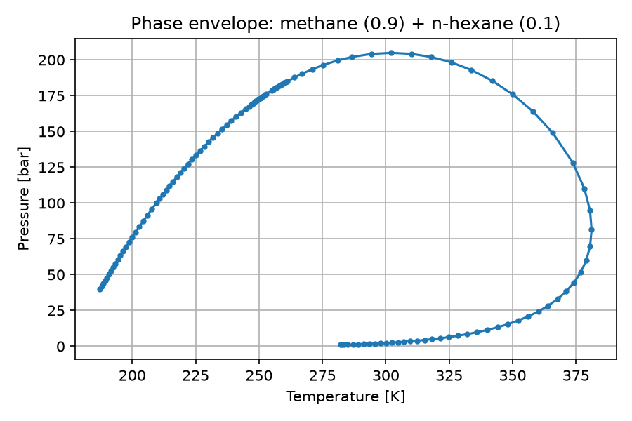
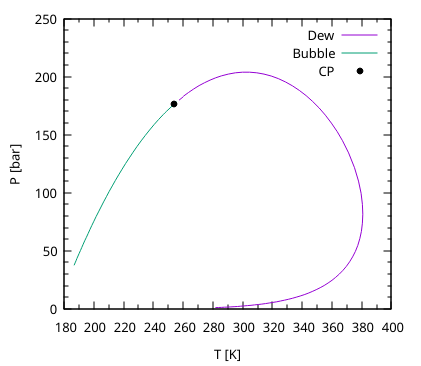

[TOC]

# Phase envelopes

A phase envelope is the set of conditions at which a feed of **fixed
composition** first splits into two phases. Below the boundary the feed is a
single phase; on the boundary a second phase appears with an infinitesimal
amount; across it, two phases coexist with finite amounts.

Think of a fixed-composition mixture of methane and n-hexane. Lowering the
pressure at constant temperature eventually makes the mixture split into a
vapor and a liquid. The temperature and pressure at which that happens form
the dew branch of the envelope. Raising the pressure instead makes the mixture
split at the bubble branch. The two branches meet at the critical point, and
together they form the closed curve that separates the single-phase region
from the two-phase region.

# Theory

Along the envelope, the incipient phase is in equilibrium with the bulk phase,
so the isofugacity condition and the saturation sum condition hold at every
point. The envelope is traced by a **continuation method**: a predictor
estimates the next point from the local tangent, and a corrector solves the
saturation equations at the new condition. Reusing the previous point as the
initial guess is what makes tracing a branch cheap and robust compared with
solving each point independently.

Isopleths are the same boundary viewed at constant global composition; they
connect the bubble and dew branches through the critical point. The name
comes from the Greek *isopleth*: a line of constant quantity.

In `yaeos` it is possible to calculate two-phase envelopes of different kinds.

- Isopleths, at constant composition (this page).
- P-x and T-x envelopes, at constant pressure or temperature while the
  composition changes, through [[px_envelope_2ph]] and [[tx_envelope_2ph]].
- Three-phase envelopes, through [[pt_envelope_3ph]].

## How a point is solved

The solver works with the logarithm of the composition ratios between the two
phases and with \(\ln P\) and \(\ln T\). Working in logarithms keeps the
variables positive and keeps the Newton steps well scaled over many orders of
magnitude. At each point it solves the isofugacity equations

$$
   \ln y_i + \ln \hat{\phi}_i(y) - \ln z_i - \ln \hat{\phi}_i(z) = 0,
$$

together with the normalization of the incipient phase
\(\sum_i (y_i - z_i) = 0\) and the specification of one variable. The phase
roots are selected from `first_point%kind`, which also decides which branch of
the envelope is followed.

# `pt_envelope_2ph`

```fortran
function pt_envelope_2ph( &
   model, z, first_point, &
   points, iterations, delta_0, specified_variable_0, &
   solver, stop_conditions, maximum_pressure &
   ) result(envelopes)
```

| Argument | Meaning |
|:---------|:--------|
| `model` | `ArModel` used for the fugacity coefficients |
| `z` | Overall composition of the isopleth (mole fractions) |
| `first_point` | Converged saturation point that starts the trace |
| `points` | Maximum number of points, default 500 |
| `iterations` | Maximum Newton iterations per point, default 100 |
| `delta_0` | Initial continuation step, default 0.01 |
| `specified_variable_0` | Index of the initially specified variable |
| `iterations`, `solver`, `stop_conditions`, `maximum_pressure` | Accepted for compatibility but **not used** by the current implementation |

The current `pt_envelope_2ph` delegates the trace to the multiphase routine
[[pt_envelope]] with one main phase and forwards only `points`, `delta_0`,
and `specified_variable_0`. In particular, `maximum_pressure` does not limit
the trace; the internal limit of 2000 bar applies.

The `first_point%kind` field selects the branches to use:

| `kind` | Bulk phase root | Incipient phase root | Resulting branch |
|:-------|:----------------|:---------------------|:-----------------|
| `"bubble"` | liquid | vapor | Bubble branch |
| `"dew"` | vapor | liquid | Dew branch |
| `"liquid-liquid"` | liquid | liquid | Liquid-liquid branch |

The trace continues from `first_point` and, when it reaches a critical point,
switches to the opposite branch. The `kind` of each saved point records which
branch it belongs to.

The continuation variable is adaptive: the solver picks the variable with the
largest sensitivity at each step, and switches away from pressure or
temperature near a critical point. `specified_variable_0` therefore sets the
starting specification rather than fixing the path.

## Example

```fortran
program phase_envelope_example
   use yaeos, only: pr, ArModel, EquilibriumState, PTEnvel2, PengRobinson76
   use yaeos, only: saturation_temperature, pt_envelope_2ph
   implicit none

   class(ArModel), allocatable :: model
   type(EquilibriumState) :: sat_point
   type(PTEnvel2) :: envelope
   real(pr) :: tc(2)
   real(pr) :: pc(2)
   real(pr) :: w(2)
   real(pr) :: n(2)
   integer :: i

   tc = [190.564_pr, 507.6_pr]
   pc = [45.99_pr, 30.25_pr]
   w = [0.0115478_pr, 0.301261_pr]

   model = PengRobinson76(tc, pc, w)

   ! Overall composition of the isopleth
   n = [0.9_pr, 0.1_pr]

   ! Start from a dew point at low pressure
   sat_point = saturation_temperature(model, n, P=1.0_pr, kind="dew", t0=150.0_pr)
   if (sat_point%kind /= "dew") error stop "The seed point did not converge"

   ! Continue the two-phase boundary
   envelope = pt_envelope_2ph(model, n, sat_point)

   print *, "Number of envelope points: ", size(envelope%points)
   if (allocated(envelope%cps)) print *, "Critical points found: ", size(envelope%cps)
   do i = 2, size(envelope%points)
      if (envelope%points(i)%kind /= envelope%points(i-1)%kind) &
         print *, "Branch change at point ", i
   end do
end program phase_envelope_example
```

With these parameters the calculation produces 122 points and one critical
point. The first points are on the dew branch, the last ones on the bubble
branch, and the critical point sits between them at about 253.8 K and
177.3 bar. The figure below shows the resulting pressure-temperature boundary:



Note the parameters: they illustrate the API, they are not a validated
description of the methane/n-hexane system.

# Output

The result is a [[PTEnvel2]] with two arrays:

| Field | Meaning |
|:------|:--------|
| `points` | Converged saturation states, in continuation order |
| `cps` | Critical points detected along the branch (`T`, `P`) |

Each entry of `points` is an [[EquilibriumState]] with `kind` (`"bubble"`,
`"dew"`, or `"liquid-liquid"`), `T`, `P`, `x`, `y`, and `beta`. In the
current implementation `x` is always the bulk phase (it equals the feed `z`)
and `y` is always the incipient phase. For a dew point this is the opposite
of the [[saturation_temperature]]/[[saturation_pressure]] convention, where
`x` holds the incipient liquid. `beta` holds the fraction of the bulk phase
(1 on the boundary), and `Vx`, `Vy`, and `iters` are not filled in, so do not
read them.

The `write` command produces a pre-formatted, sectioned file:

```
# PTEnvel2

# kind of sat point
kind T P beta [phase-x composition vector] [phase-y composition vector]

# other kind of sat point
kind T P beta [phase-x composition vector] [phase-y composition vector]

# Critical
T P
```

The current writer emits every point **except the last one**, so the file
contains one row fewer than `size(envelope%points)`. The beta column is
present in the data rows and precedes the composition vectors.

Which when plotted with `gnuplot` with:

```gnuplot
plot "outfile" \
        index "dew"      u 2:3 w l title "Dew", \
     "" index "bubble"   u 2:3 w l t "Bubble", \
     "" index "Critical" u 1:2 w p pt 7 lc rgb "black" t "CP"
```

Gives the following plot:



# Related routines

| Routine | Boundary traced | Fixed quantity |
|:--------|:----------------|:----------------|
| [[pt_envelope_2ph]] | P-T at constant composition | Composition |
| [[px_envelope_2ph]] | P-x at constant temperature | Temperature and a feed/injection pair |
| [[tx_envelope_2ph]] | T-x at constant pressure | Pressure and a feed/injection pair |
| [[pt_envelope_3ph]] | P-T for a three-phase line | Composition and initial phase compositions |

The P-x and T-x routines take two compositions, `z0` (the main phase) and
`z_injection` (the injected fluid), plus a mixing parameter `alpha0`. They are
useful for injection and leaching processes, where the composition of one
phase changes along the path.

# Practical notes

- Start from a converged saturation point of the same kind as the branch you
  want to follow. A bad seed is the most common cause of a short or empty
  envelope.
- Reuse the previous point when you need a single point rather than a whole
  curve: a saturation calculation with the previous `y0` and pressure or
  temperature as the initial guess is usually cheaper and more stable.
- The critical point is detected when the logarithm of the composition ratios
  changes sign between two consecutive points; the crossing is interpolated and
  the two phase kinds are swapped, which is what produces the branch change.
  The interpolated point is reported in `cps`. If the trace crosses a critical
  point without the sign change being detected, the branch change is missed.
  Compare `size(cps)` with the number of branch changes you expect.
- Near a critical point the two phases become nearly identical and the solver
  reduces its step size and jumps over the region. Points close to the critical
  point are the least reliable ones in the set; treat them as indicative.
- The trace stops when the internal 2000 bar limit is reached, when the step size
  collapses, when a point fails to converge, or when the requested number of
  points is reached. A short envelope is not necessarily a wrong one.
- Check the branch labels and the phase fractions along the envelope. A
  negative or inconsistent fraction means the trace left the physical branch.
- A liquid-liquid branch uses different root and step settings, and its
  points are the least well tested part of the implementation. Verify each
  point independently before using a liquid-liquid envelope.
- See `example/basics/4_phase_envelope.f90` for a complete runnable program,
  including how to write the envelope to a file.
